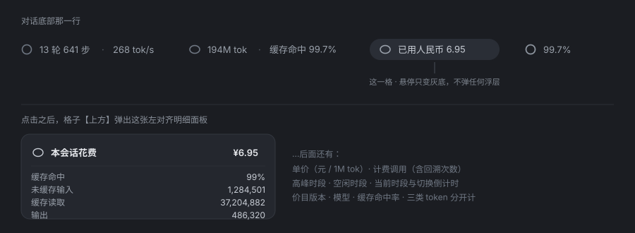

# dsh-cost-meter

**给 DeepSeek Harness（DSH）装上一只电表：底部读数行多一格「已用人民币 X」，按官方峰谷定价算，每个会话各记各的账。**

**A real cost meter for DeepSeek Harness: one more cell in the composer readout — "已用人民币 X" — priced with DeepSeek's peak/off-peak tariff, accounted per session.**

[](https://github.com/topics/dsh-plugin)
[](LICENSE)
[](package.json)



> 上图是**界面复刻**（直接用插件与官方组件同一套 CSS 画的，见 [`assets/mockup.html`](assets/mockup.html)）。
> 想要真机截图：在浏览器里打开那个文件、截两块，存成 `assets/screenshot-1.png` /
> `assets/screenshot-2.png`，再把这里换掉即可。

---

## 它解决什么 / Why

DSH 的底部那行会告诉你**用了多少 token**，但不会告诉你**花了多少钱**。而 DeepSeek 的价格是分时段的、也分缓存命中与否 —— 你自己拿计算器算，算出来的数字通常和账单差得很远。

这个插件把那笔账实时算给你看，**只算官方通道**：

- 底部多一格 `已用人民币 6.95`，字体、颜色、内边距与旁边原生那两粒**逐字对齐**（不是"看着差不多"）；
- 鼠标悬停只是变灰底，**不弹任何浮层**；点一下，上方弹出一张左对齐的明细卡；
- 换到第三方中转渠道时，**那一行一个字符都不变** —— 插件不猜、不编、不显示别人的账。

DeepSeek's own readout tells you how many tokens went by; it does not tell you what they cost. Prices vary by time of day and by whether the prompt hit the cache, so hand-arithmetic tends to land far from the invoice. This plugin prices it live, **for the official channel only**, and leaves the row untouched for third-party providers.

## 功能一览 / What you get

| 能力 | 一句话 |
| --- | --- |
| [只在官方通道计费](#计费口径--billing-rules) | 认的是 **provider 路由名**，不是模型名 —— 中转站里叫 `Deepseek-v4-flash` 的模型不算 |
| [峰谷定价](#峰谷定价--peak-and-off-peak) | 北京时间工作日 9–12 / 14–18 高峰，其余空闲；空闲价 = 高峰价一半 |
| [三类 token 分别计价](#三类-token-分别计价--three-token-buckets) | 缓存命中输入 / 未命中输入 / 输出，各自两档，不混算 |
| [每会话独立账本](#一个会话一本账--one-ledger-per-session) | 每个 session 各记各的，子代理也不会串到你的数字里 |
| [增量累加，绝不重算](#增量-vs-重算--incremental-never-recompute) | 每次调用只往上加一笔，不每次从头回放 |
| [回溯补齐](#回溯补齐--backfill) | 中途装上也能从**会话第一天**算起，读会话日志逐条补 |
| [定价政策变化可迁移](#定价政策变了怎么办--when-the-tariff-changes) | 账本存价目指纹，变了才按新价重放一次，且**只认贵不认便宜** |
| [价目表有版本](#价目表--the-tariff-table) | 旧的按 `effectiveFrom` 分段按旧价，不会被新价追溯 |
| [悬停不弹东西](#界面--the-ui) | 只有灰底；明细在点击后出现 |
| [离线可测](#测试--tests) | 108 项断言，不开浏览器就能证明口径没算错 |

## 安装 / Install

插件是**一个真正的 profile bundle**，所以它会出现在「设置 → 插件」的列表里，可以启用 / 停用 / 卸载。

```sh
dsh plugin --profile <你的 profile> add dsh-cost-meter
dsh plugin --profile <你的 profile> add <git-url-or-path>   # 或从仓库/本地目录
```

装完**重启一次 DSH**（它是宿主组合里的一行，不是纯运行时热加载）。

Restart the profile afterwards: the plugin is a row in the host composition.

卸载 / Uninstall：`dsh plugin --profile <profile> remove dsh-cost-meter`

### 从源码目录装（开发用）

```sh
dsh plugin --profile desktop add link:/path/to/dsh-cost-meter
```

用 `link:` 装的话，改完文件**不需要重新安装**：只改浏览器半
（`client.js`）存盘即生效（HMR 自动换版本）；改宿主半
（`dsh-cost-meter.mjs`）要重启 DSH。

## 快速上手 / Quick start

装上、重启，然后随便聊几句。底部那一行末尾就会出现：

```
1 轮 · 3 步 · 12 tok/s   48.2K tok · 缓存命中 93%   已用人民币 0.42   26%
```

**点它**，上方弹出明细卡：

```
本会话花费                                    ¥0.42
─────────────────────────────────────────────────
缓存命中                                        93%
未缓存输入                                   3,412
缓存读取                                    48,900
输出                                         1,204
单价（元 / 1M tok）                    0.02 / 1 / 4
计费调用                          计价 7 次，含回溯 2 次
当前时段                            空闲档，2 小时 15 分钟后切换
价目版本                                 2026-09-10
模型                                 deepseek-flash
```

## 计费口径 / Billing rules

### 只认 provider 路由名，不认模型名 / Route name, not model name

这是整个插件**最重要的一条**。判断"这通调用该不该计费"看的是 **provider 路由名**：

```
deepseek-official · deepseek-account · deepseek · deepseek-api-key
另有兜底：任何以 deepseek- 开头的自有路由
```

所以：

- ✅ **官方账号登录** → 算
- ✅ **自己的官方 API Key** → 算
- ✅ **别人的官方 Key**（走同一个 provider）→ 算
- ❌ **第三方中转站**（`llm-pi-ai` 里的 `yuni` 之类）→ **不算，一个字符都不显示**

为什么不用模型名判断：中转站里大量模型就叫 `［phythm］Deepseek-v4-flash`。按名字判断会把这些第三方渠道的花销算进"官方花费"里，数字立刻变成假的。想额外把某个路由认成官方，写进 `cost-config.json` 的 `providers` 就行。

### 峰谷定价 / Peak and off-peak

按官方口径，**北京时间**（`Asia/Shanghai`）：

| 时段 | 什么时候 |
| --- | --- |
| **高峰**（单价 ×2） | 周一至周五 `9:00–12:00`、`14:00–18:00` |
| **空闲**（半价） | 其余所有时间，含周末与中国法定节假日 |

明细卡里会写「当前时段」以及**还有多久切换**（`空闲档，2 小时 15 分钟后切换`），所以你能决定"要不要等一会儿再跑这活"。

### 三类 token 分别计价 / Three token buckets

官方对 prompt 侧和输出侧定价不同，且命中/未命中缓存也不同价。DSH 的 `TokenUsage` 里 `inputTokens` **就是**未命中数（官方定义 `prompt_tokens = prompt_cache_hit_tokens + prompt_cache_miss_tokens`），所以三类分开算：

```
花费 = (命中 × 命中价 + 未命中 × 未命中价 + 输出 × 输出价) / 1e6
```

**缓存命中率也按同一口径算**：`命中 / (命中 + 未命中)`。刻意和计费同源 —— 否则会出现"命中率 99% 但金额对不上"这种没法和账单对照的数字。

### 价目表 / The tariff table

来源 <https://api-docs.deepseek.com/zh-cn/quick_start/pricing>（元 / 1M tokens）：

| 模型 | 时段 | 命中 | 未命中 | 输出 |
| --- | --- | --- | --- | --- |
| `deepseek-flash` | 空闲 | 0.02 | 1 | 4 |
| `deepseek-flash` | 高峰 | 0.04 | 2 | 8 |
| `deepseek-v4-pro` | 空闲 | 0.15 | 4.5 | 13.5 |
| `deepseek-v4-pro` | 高峰 | 0.3 | 9 | 27 |

价目表**带版本**：每条有 `from`（生效时刻）和 `id`。历史区间按 `effectiveFrom` 分段 —— 旧调用永远按**当时**的价算，不会被新价追溯。官方明文说仍可调用、按 Flash 计价的旧名（`deepseek-v4-flash`、`deepseek-v4-flash-vision-exp`）已做映射。

> **不认识的模型**：官方通道上遇到价目表里没有的模型，会记一笔「未计价」并在明细里说明，**绝不编一个数字**。

## 它是怎么记的 / How the accounting works

### 一个会话一本账 / One ledger per session

```
${DSH_HOME}/dsh-cost/ledger.json
```

v2 schema，每个 session 一条：金额、峰谷各自的小计、按模型的桶、调用次数、价目指纹。**子代理有独立的会话 id，花销记在各自的账本里** —— 所以底部那一格显示的永远是**当前会话**的钱，不会把子代理的开销糊进来。

插件的 `llm/stream` 钩子观测到 `usage` chunk 就记一笔。适配器一次调用可能吐多个 usage，只记**最后一个**，且只记一次。

### 增量 vs 重算 / Incremental, never recompute

**平时永远只做加法。** 每次调用往上加一笔，从不回放整个会话。

唯一的例外是价目指纹变了（见下）—— 那时候才精确重放一次，而且**按记录的三类 token 与历史峰谷调用次数分摊**，不是粗暴地乘一个系数。

### 回溯补齐 / Backfill

中途才装插件的话，只算"从装载那刻起"显然不对。所以每个会话**第一次**被记账时，插件会去读它的会话日志：

```
${DSH_HOME}/sessions/<slugified-cwd>/<sessionId>/*.jsonl.zstd
```

每个 append 是**独立的 zstd 帧**，所以按魔数 `28 B5 2F FD` 切片逐帧解压；每条 `assistant/message` 带着 `time` 和 `data.usage`，按**各自发生时刻**的峰谷档补进账本。防重复的判据是账本里的 `firstAt`，实时记账与回溯区间严格不重叠。

明细卡里会写「含回溯 N 次」，所以你能看出这个数字的覆盖面。补不到的（比如日志已被清理）会退回显示「从装载那刻起计」。

### 定价政策变了怎么办 / When the tariff changes

账本里存着一个**定价指纹**（价目表 + 峰谷规则 + 节假日表 + 时区 + schema 版本的摘要）。发现某会话的指纹与当前不一致时：

1. 用当前价目把该会话的历史累计 token **精确重算一次**，写回新指纹；
2. 之后继续走增量。

重算带**下限保护：只会认得更贵，不会让已显示的金额缩水**（避免"数字变小了"这种事发生在已经给你看过的金额上）。

要改价或加新档位：编辑 `TARIFFS` **新增**一条 `from` 更晚的记录 —— **不要改旧档位的数字**，那会让历史被新价追溯。

## 界面 / The UI

底部那一格**不是自己开一行**，而是注册进原生读数行所在的槽位
（`conversation.composer.dock`，原生 session-stats 就在那儿），`order: 10` 排在它后面。

排版是**逐条抄**原生实现的，不是估的：

| 元素 | 抄的是谁 | 关键参数 |
| --- | --- | --- |
| 底部那一格 | `@deepseek-ai/dsh-client-ui-chat` 的 `StatsPills.module.css` | `font-size: calc(var(--dsh-content-font-size-secondary,13px) - 1px)`、`color: var(--dsw-alias-label-tertiary)`、`padding: 1px 8px`、`border-radius: 999px`、图标 14×14 |
| 点击面板 | 官方 `stat-dialog.module.css` | `border-radius: var(--dsw-radius-lg)`、`background: var(--dsw-specific-menu)`、`padding: 16px`、标题行 + `.5px` 分隔线 + `dl` 两列网格 |

悬停**只变灰底**（与原生那两粒完全一致），**不弹任何浮层**；明细只在点击时以面板形式给出（点外部或 `Esc` 关闭）。无障碍名称带一行摘要，键盘 / 屏幕阅读器用户不缺信息。

> 试过两版悬停提示都被否决了，原因都记在 `UI-NOTES.md` 里：官方 `Tooltip` 原语的气泡底色令牌**在浅色主题下也是深灰近乎黑**（`dsw-static-neutral-bluish-850`），放在这行浅色读数旁边就是一块黑方块；自绘浅色版则是"根本不需要悬停出东西"。底部那行是"安静读数"的地方。

## 配置 / Configuration

可选，不建也能跑：

`${DSH_HOME}/dsh-cost/cost-config.json`

```json
{
  "holidays": ["2027-01-01", "2027-02-06"],
  "providers": ["my-official-gateway"],
  "currency": "CNY",
  "showPeakBadge": true
}
```

| 字段 | 作用 |
| --- | --- |
| `holidays` | 追加"全天算空闲"的日期。**国务院公布当年安排后填这里**，改完下个轮询周期生效 |
| `providers` | 额外把这些 provider 路由名认成官方通道 |
| `currency` | 只影响符号显示（默认 `CNY`） |
| `showPeakBadge` | 是否显示峰谷徽标 |

> 2026 年节假日表是**按近年规律预排**的，不是官方原文。影响面很小：某天被误判成高峰，只会让当天那几次调用按高峰价计（正好贵一倍），平时判定不受影响。

## 只读接口 / Read-only API

`GET /dsh-cost/api`（借用 harness 自己的信任闸 `connection.requestRejection`，**要用浏览器会话凭据读**；裸 curl 会拿到 401，那是**对的** —— 404 才说明没挂载）。

| scope | 作用 |
| --- | --- |
| `?scope=session&sessionId=…` | 指定会话的快照（浏览器半就用这个取数） |
| `?scope=all` | 所有会话的目录 |
| `?scope=current` | 兜底：只有账本里**只有一个会话**时才敢认，否则说"不知道" |
| `?scope=dump` | 自诊断：账本 + 价目 + 当前峰谷 + 指纹，用来核对数字从哪来 |

## 测试 / Tests

**108 项断言，0 失败**，不需要开浏览器：

```sh
node verify/check-client-bundle.mjs        # 66 项：浏览器半契约 + 界面口径
node --experimental-vm-modules verify/dsh-cost-selftest.mjs   # 42 项：宿主半记账
```

覆盖的是那些**容易"看着对、其实错"**的地方：

- 金额格式：`4.505978 → 4.51`、`0.5 → 0.50`、**`0.0042` 不许显示成 `0.00`**（花了钱就得看见）
- 缓存命中率与**计费**同源：`3M/(3M+1M) = 75%`
- 三类 token 分开、回溯次数写进计费行、峰谷小计分开
- 字号 / 颜色 / 内边距 / 圆角**逐字**匹配 `StatsPills` 的声明
- **没有悬停浮层**（防止以后自己又给加回来）
- 面板在**上方**（`side: top`）、悬停无浮层、`apply` 在缺少官方原语时不抛错、无 `sessionId` 时返回 `null`
- 合成日志**精确对账**：手算峰谷金额与账本分毫不差
- 真实会话日志**端到端**：回溯补齐后金额与逐条重算一致

## 已知限制 / Limitations

- **是估算，不是账单。** 官方没有价格查询接口，这里是按公示价目表算的。要跟账单对，看的是量级和相对关系。
- **单次调用跨峰谷切换点时，按调用完成时刻归档**，不按时长摊分。
- **子代理不并进当前会话那一格**（各自的会话、各自的账本，这是设计）。
- **2026 节假日表是按惯例预排**，非官方原文；公布后用 `cost-config.json` 覆盖。
- **第三方渠道不显示任何东西** —— 这是设计约束，不是缺陷。
- 价目表**要跟着官方更新**：官方改价后需要新增一条 `TARIFFS` 记录（改完重启）。

## 文件结构 / Layout

```
dsh-cost-meter/
├── dsh-cost-meter.mjs     # 宿主半：价目表、账本、llm/stream 计量、回溯、只读路由
├── client.js              # 浏览器半：底部那一格 + 点击面板（官方 dsh.client 惰性工厂）
├── cordis.patch.yml       # bundle 补丁：本包被装成依赖时插哪一行
├── locale/zh.json         # 插件列表里显示的中文名与说明
├── package.json           # dsh.bundle.patch（让它进插件列表）+ dsh.client（提供浏览器半）
├── examples/cost-config.json  # 可选配置示例（节假日表、额外官方 provider）
├── assets/                # README 图与离线复刻页
├── INSTALL.md             # 安装与故障排查
├── UI-NOTES.md            # 界面口径：抄了官方哪些声明、为什么，以及踩过的坑
├── CHANGELOG.md
└── LICENSE
```

## License

MIT —— 见 [LICENSE](LICENSE)。
